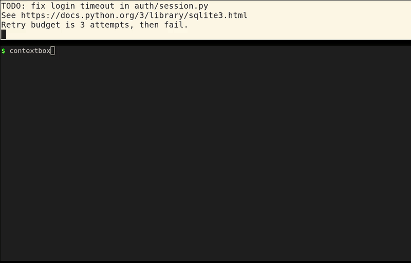

# ContextBox



Screenshot your screen from the terminal, pull out the text and links, and search them later.

```bash
pip install "contextbox[ocr] @ git+https://github.com/jayhemnani9910/contextbox.git"
```

[](https://github.com/jayhemnani9910/contextbox/actions/workflows/ci.yml)

Docs site: https://jayhemnani9910.github.io/contextbox/

OCR also needs the Tesseract binary, and on Linux a screenshot tool. On Debian or Ubuntu:

```bash
sudo apt install tesseract-ocr scrot
```

## Usage

```bash
contextbox capture          # screenshot, OCR, find URLs, save
contextbox list             # what you have saved
contextbox search login     # find captures by any word that was on screen
contextbox stats            # count and database size
```

Add `--log-level error` before the command to hide the log lines.

Everything is stored in `contextbox.db` in the folder you run it from, and each capture also writes a JSON file and the PNG to `artifacts/`:

```json
"extracted": {
  "text": "TODO: fix login timeout in auth/session.py\nSee https://docs.python.org/3/library/sqlite3.html ...",
  "urls": ["https://docs.python.org/3/library/sqlite3.html"]
}
```

Move captures between machines with export and import:

```bash
contextbox export --all-contexts --format json -o captures.json   # also csv, txt, markdown
contextbox import captures.json
```

`contextbox ask` and `contextbox summarize` are in the CLI but not implemented yet. They print a message and exit.

## How it works

1. `capture` takes a screenshot with `scrot`, `gnome-screenshot` or `flameshot` on Linux, `screencapture` on macOS, or `pyautogui` on Windows.
2. `pytesseract` reads the text out of the PNG. If OCR is not installed or finds no text, it saves basic system info instead (time, platform, working directory, and the `USER`, `HOME`, `SHELL`, `PATH` and `VIRTUAL_ENV` variables).
3. A regex pulls URLs out of the text.
4. The capture goes into SQLite, and `search` is a SQL `LIKE` match over the stored text, window titles and URLs.

I have run it on Linux. The macOS and Windows paths are in the code but untested.

## Python API

```python
from contextbox import ContextBox

app = ContextBox({"database": {"db_path": "contextbox.db"}})

context_id = app.capture_context({"active_window": {"title": "Terminal"}, "clipboard": "copied text"})
results = app.database.search_contexts("copied")
context = app.get_context(context_id)
```

There is also a Wikipedia extractor:

```python
from contextbox.extractors import extract_wikipedia_content

page = extract_wikipedia_content("https://en.wikipedia.org/wiki/SQLite")
page["metadata"]["title"]  # "SQLite"
```

`contextbox.llm` has a client for [GitHub Models](https://github.com/marketplace/models) (`pip install "contextbox[llm] @ git+..."`, then set `GITHUB_TOKEN`). The default model is `gpt-4o-mini`. The CLI does not use it yet.

Install the `web` extra for webpage extraction with `contextbox.extractors.extract_webpage_content`:

```bash
pip install "contextbox[web] @ git+https://github.com/jayhemnani9910/contextbox.git"
```

## Development

```bash
git clone https://github.com/jayhemnani9910/contextbox.git
cd contextbox
pip install -e ".[dev,ocr]"
pytest
```

See [CONTRIBUTING.md](CONTRIBUTING.md).

## License

MIT
